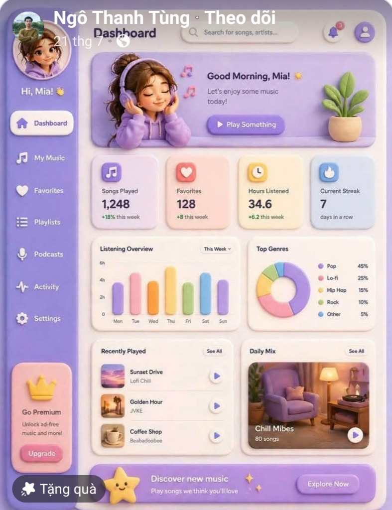

# TÀI LIỆU ĐẶC TẢ NGHIỆP VỤ & KỸ THUẬT (BRD & SRS)

* **Tên Dự Án (Project Name):** **EduTrack Lite** – Hệ thống Quản lý Lớp Dạy Thêm & Học Sinh Tinh Gọn
* **Tên Tài Liệu (Document Title):** Tài liệu Đặc tả Yêu cầu Nghiệp vụ và Giải pháp Kỹ thuật (Business & System Requirements Specification)
* **Phiên bản:** 1.2 *(v1.1: cấu trúc Menu Mobile-First, tách chu kỳ học khỏi công nợ, học sinh học nhiều môn/vào giữa kỳ, VietQR & đối soát Tiền mặt/Chuyển khoản, chuẩn hóa Database Schema. v1.2: bổ sung Phần 6 – Phong cách giao diện "Soft Clay Pastel")*
* **Mục tiêu cốt lõi:** Xây dựng ứng dụng Web/Mobile Web (PWA) tốc độ cao, tối giản thao tác (1–2 chạm) dành cho các trung tâm dạy thêm và giáo viên cá nhân. Giải quyết trọn vẹn việc quản lý ca học, điểm danh tức thì, tự động tính học phí linh hoạt (khấu trừ buổi nghỉ có phép, vào giữa kỳ), đối soát dòng tiền Tiền mặt/Chuyển khoản và minh bạch hóa lịch sử thao tác (Audit Log) giữa Admin và các Giáo viên.

---

## PHẦN 1: QUY TẮC NGHIỆP VỤ & PHÂN QUYỀN (ROLES & PERMISSIONS)

Hệ thống vận hành theo mô hình Multi-tenant (đa trung tâm) và chia làm 4 cấp độ tài khoản (Role) phân cấp từ trên xuống:

| Role | Mã Role | Mô tả & Quyền hạn chi tiết |
| :--- | :--- | :--- |
| **Operator** | `ROLE_OPERATOR` | • Chủ sở hữu hệ thống phần mềm. • Quản lý danh sách **Trung tâm (`Center`)** và tài khoản `Admin` đại diện. • Khóa/Mở khóa ở cấp độ **toàn bộ Trung tâm** (khi Trung tâm bị khóa, mọi tài khoản `Admin`, `Giáo viên`, `Học sinh` thuộc trung tâm đó đều bị chặn đăng nhập). • Xem chỉ số vận hành tổng quan (số lớp, số học sinh, dung lượng lưu trữ), không can thiệp vào dữ liệu chuyên môn nội bộ của từng trung tâm. |
| **Admin** | `ROLE_ADMIN` | • Chủ trung tâm dạy thêm hoặc Giáo viên tự mở lớp dạy 1 mình. • Tạo, sửa, khóa tài khoản `Giáo viên`; cấu hình thông tin Trung tâm & tài khoản ngân hàng nhận học phí (**VietQR**). • **Quyền kế thừa mặc định:** Tài khoản Admin tích hợp sẵn 100% quyền của `Giáo viên` (nếu trung tâm chỉ có 1 người thì Admin trực tiếp đứng lớp, điểm danh, thu phí mà không cần tạo hay đổi qua tài khoản Giáo viên riêng). • Xem toàn bộ danh sách lớp/ca, công nợ học phí, bảng đối soát **Tiền mặt vs Chuyển khoản** cuối ngày và **Nhật ký hoạt động (Audit Log)** của tất cả giáo viên. |
| **Giáo viên** | `ROLE_TEACHER` | • Chỉ nhìn thấy và thao tác trên các Lớp/Ca học được Admin phân công phụ trách. • Tạo mới hoặc tìm gán tài khoản `Học sinh` sẵn có của trung tâm vào lớp mình dạy. • Thực hiện nghiệp vụ hàng ngày: Điểm danh, cộng điểm khuyến khích, nhập điểm kiểm tra, viết nhận xét học tập (công khai cho phụ huynh) & ghi chú nội bộ, đăng ảnh Bài tập về nhà (BTVN), xác nhận thu học phí (chọn rõ Tiền mặt hoặc Chuyển khoản). • Xem số tiền mặt bản thân đã thu trong ngày để bàn giao cho Admin; truy cập Kho tài liệu dạy học. |
| **Học sinh / Phụ huynh** | `ROLE_STUDENT` | • Học sinh và Phụ huynh dùng chung 1 tài khoản do Giáo viên/Admin cấp (1 tài khoản dùng chung cho mọi môn/ca học mà học sinh theo học tại trung tâm). • **Quyền Chỉ Xem (View-Only):** Chỉ truy cập được duy nhất **Cổng Học Sinh & Phụ Huynh** của chính mình để xem thông báo học phí (kèm mã QR chuyển khoản), ảnh BTVN, lịch sử chuyên cần, điểm cộng, điểm kiểm tra và nhận xét công khai của giáo viên. Không có quyền chỉnh sửa dữ liệu và tuyệt đối không nhìn thấy ghi chú nội bộ. |

---

## PHẦN 2: CẤU TRÚC ĐIỀU HƯỚNG & MENU (NAVIGATION ARCHITECTURE)

Thiết kế tuân thủ nguyên tắc **Mobile-First**: trên điện thoại sử dụng **Thanh điều hướng đáy (Bottom Navigation Bar – tối đa 5 mục)** để bấm bằng 1 ngón tay cái; trên máy tính tự động chuyển thành **Thanh menu dọc bên trái (Left Sidebar)**.

### 2.1. Menu dành cho `Admin` và `Giáo viên`
> **Nguyên tắc tốc độ:** Không dùng trang Dashboard biểu đồ rườm rà làm trang mặc định. Sau khi đăng nhập, hệ thống mở thẳng màn hình **`Ca học`** để giáo viên đứng lớp thấy ngay ca đang dạy trên cùng và bấm điểm danh ngay lập tức.

| STT | Tên mục Menu | Hiển thị cho | Chức năng & Các màn hình / Tab con bên trong |
| :-: | :--- | :--- | :--- |
| **1** | **Ca học** *(Trang chủ)* | Admin, Giáo viên | • Danh sách thẻ Ca học (ghim Ca *Đang trong giờ học* lên đầu + dải tóm tắt nhanh số ca hôm nay). • Bấm vào 1 Ca mở **Màn hình Chi tiết Ca học** gồm 4 tab con:   1. `Điểm danh & +1 điểm` *(Mặc định mở)*   2. `BTVN`   3. `Học sinh trong ca`   4. `Kỳ học phí của ca` |
| **2** | **Học phí** *(Có badge đỏ đếm nợ)* | Admin, Giáo viên | • Quản lý tập trung toàn bộ hóa đơn học phí của các ca mình quản lý/phụ trách, chia 2 tab:   1. **Chưa đóng:** Danh sách học sinh còn nợ phí của các kỳ (xác nhận thu 1 chạm `Tiền mặt` / `Chuyển khoản`, điều chỉnh cộng/trừ phí).   2. **Đối soát hôm nay:** Tổng hợp tiền thu trong ngày tách bạch theo **Tiền mặt từng giáo viên đang cầm** và **Chuyển khoản về STK trung tâm**. |
| **3** | **Học sinh** *(Danh bạ chung)* | Admin, Giáo viên | • Tra cứu nhanh học sinh theo tên/username mà không cần nhớ học sinh thuộc ca nào. • Xem danh sách các môn/ca học sinh đang theo học, tổng nợ các môn, bấm **Copy thông tin Zalo** hoặc **Reset mật khẩu** tức thì. |
| **4** | **Tài liệu** | Admin, Giáo viên | • Kho tài liệu dạy học nội bộ: Tìm kiếm tức thời theo tiêu đề + lọc theo `Lớp 1..12`, `Tài liệu khác` + Upload tài liệu mới. |
| **5** | **Quản trị** *(Với GV hiển thị là **Cá nhân**)* | Admin *(Đầy đủ)* Giáo viên *(Rút gọn)* | • Trên điện thoại gom gọn vào mục thứ 5; trên máy tính hiển thị thành nhóm riêng trên Sidebar:   1. **Nhật ký hoạt động (`Audit Log`):** *(Chỉ Admin)* Lọc lịch sử thao tác và đối soát.   2. **Quản lý Giáo viên:** *(Chỉ Admin)* CRUD tài khoản giáo viên.   3. **Cài đặt & VietQR:** *(Chỉ Admin)* Tên trung tâm, STK ngân hàng nhận học phí, quy tắc làm tròn đơn giá buổi học.   4. **Tài khoản cá nhân:** *(Cả Admin & GV)* Đổi mật khẩu; riêng Giáo viên có thẻ tóm tắt *"Tiền mặt tôi đã thu hôm nay cần bàn giao cho Admin"*. |

### 2.2. Menu dành cho `Học sinh / Phụ huynh` (`ROLE_STUDENT`)
Giao diện tối giản tối đa khi mở từ link Zalo trên điện thoại:
* **Thanh tiêu đề trên cùng (Header Class Switcher):** Nếu học sinh học **từ 2 môn/ca trở lên** tại trung tâm, hiển thị nút chọn chuyển nhanh môn học (VD: `[Toán Lớp 4 - Ca 1 ▾]`). Nếu chỉ học 1 ca thì hiển thị tên lớp cố định.
* **3 Tab điều hướng dưới đáy:**
  1. **Tổng quan & Học phí:** Thẻ thông báo học phí + nút mở mã **VietQR** (nếu có kỳ chưa đóng) ghim nổi bật trên cùng, ngay bên dưới là BTVN buổi mới nhất.
  2. **Bài tập về nhà:** Toàn bộ danh sách ảnh BTVN của lớp theo dòng thời gian.
  3. **Kết quả học tập:** Lịch sử chuyên cần chi tiết, Điểm cộng tích lũy, Bảng điểm kiểm tra & xu hướng phát triển, Nhận xét của giáo viên.

### 2.3. Menu dành cho `Operator` (`ROLE_OPERATOR`)
Giao diện quản trị hệ thống độc lập gồm 2 mục trên Sidebar:
1. **Danh sách Trung tâm (`Centers`):** Tạo trung tâm mới + tài khoản `Admin` đầu tiên, theo dõi quy mô (số lớp, số học sinh, dung lượng file), Khóa/Mở khóa trung tâm, Reset mật khẩu Admin.
2. **Tài khoản Hệ thống:** Đổi mật khẩu bảo mật cho Operator.

---

## PHẦN 3: ĐẶC TẢ CHI TIẾT CÁC PHÂN HỆ CHỨC NĂNG

### MODULE 1: QUẢN LÝ TRUNG TÂM & TÀI KHOẢN (CENTER & ACCOUNT MANAGEMENT)
1. **Đăng nhập / Đăng xuất:**
   * Sử dụng `Username` và `Password` (không bắt buộc dùng Email hay SĐT để tránh rườm rà cho học sinh nhỏ tuổi).
   * Hệ thống kiểm tra đồng thời trạng thái tài khoản (`users.is_active`) và trạng thái hoạt động của trung tâm (`centers.is_active`).
2. **Quản lý Trung tâm & Admin (Dành cho Operator):** CRUD Trung tâm, cấp tài khoản Admin đại diện, khóa/mở khóa toàn trung tâm.
3. **Quản lý Giáo viên & Cài đặt VietQR (Dành cho Admin):**
   * CRUD tài khoản Giáo viên trong trung tâm.
   * Cấu hình thông tin ngân hàng nhận học phí (`Ngân hàng`, `Số tài khoản`, `Tên chủ tài khoản`) để hệ thống tự động sinh ảnh mã **VietQR** trên cổng Phụ huynh.
4. **Thêm Học sinh vào Ca học – Hỗ trợ học nhiều môn (Dành cho Admin/Giáo viên):**
   * Thực hiện ngay trong màn hình chi tiết Ca học với 2 lựa chọn:
     * **Chọn học sinh đã có trong trung tâm:** Gõ tìm tên học sinh đã học môn khác tại trung tâm để gán thêm vào Ca học này (dùng chung 1 tài khoản duy nhất).
     * **Tạo mới hoàn toàn:** Chỉ cần nhập `Họ và tên học sinh`, hệ thống tự động sinh `Username` không trùng lặp (VD: `nguyenvannam_24`) và `Password` mặc định là **chuỗi 6 ký tự/chữ số ngẫu nhiên** *(tuyệt đối không dùng mật khẩu cố định `123456` để ngăn học sinh cùng lớp tự đoán mật khẩu của nhau)*.
   * Cung cấp nút **"Copy thông tin đăng nhập"** (format sẵn đoạn tin nhắn gồm Tên HS + Link Web + Username + Password) để giáo viên dán gửi qua Zalo cho phụ huynh chỉ bằng 1 chạm.
   * Cung cấp nút **Reset Password** sinh mật khẩu ngẫu nhiên mới và tự động copy vào bộ nhớ tạm nếu học sinh/phụ huynh quên mật khẩu.

---

### MODULE 2: QUẢN LÝ LỚP & CA HỌC (CLASS & SHIFT MANAGEMENT)

Một khối lớp (VD: Lớp 3, Lớp 4) có thể có nhiều Ca học. Đơn vị quản lý vận hành trực tiếp là **Ca học**.

#### 2.1. Màn hình Danh sách Lớp / Ca học
* **Chức năng CRUD Ca học:** Khi tạo/sửa một Ca học cần các trường dữ liệu:
  * `Tên Lớp / Ca` (VD: Toán Lớp 4 - Ca 1).
  * `Khối lớp` (`Lớp 1` → `Lớp 12`, hoặc `Khác` dùng để phân nhóm).
  * `Giáo viên phụ trách` (Chọn từ danh sách giáo viên, mặc định là Admin tạo lớp).
  * `Lịch học trong tuần`: Chọn các Thứ trong tuần và khung giờ (VD: Thứ 3: 17:30 – 19:00, Thứ 6: 17:30 – 19:00).
  * `Cấu hình chu kỳ học phí`:
    * Số buổi của 1 chu kỳ thu phí (VD: `16 buổi` tương đương 8 tuần, mỗi tuần 2 buổi).
    * Học phí gốc cho 1 chu kỳ (VD: `800.000 VNĐ`).
    * Đơn giá khấu trừ 1 buổi nghỉ có phép: Hệ thống tự tính `Học phí chu kỳ / Số buổi` và làm tròn theo quy tắc trung tâm (VD: làm tròn đến hàng nghìn VNĐ, cho phép Admin chỉnh tay nếu phép chia lẻ như `1.000.000 / 12 buổi = 83.000 VNĐ/buổi`).
* **Hiển thị trên Thẻ Ca học (Card View):** Tên Ca, Sĩ số đang theo học (`ACTIVE`), Lịch học, Giáo viên phụ trách, Tiến độ chu kỳ hiện tại (VD: `Kỳ 3 • Buổi 12/16`), và Nhãn cảnh báo nợ nếu ca còn hóa đơn kỳ trước chưa thu xong (VD: `Còn 4 HS chưa đóng phí`).
* **Logic Tự động Highlight & Chuyển giao Chu kỳ mượt mà (Không bị kẹt lớp):**
  1. **Highlight "Đang trong giờ học":** Khi thời gian thực của thiết bị nằm trong khung giờ học của Ca (±15 phút trước/sau giờ học), thẻ Ca học tự động đổi viền nổi bật (Màu xanh lá) và ghim lên đầu danh sách.
  2. **Tự động chốt kỳ thu phí mà không khóa điểm danh kỳ mới:** Ngay khi buổi điểm danh của Ca chạm mốc chu kỳ (VD: hoàn thành buổi `16/16` của Kỳ 3), hệ thống tự động:
     * Khởi tạo bảng hóa đơn học phí cho **Kỳ 3** (trạng thái `OPEN`, bật cảnh báo đỏ thu phí trên thẻ lớp và menu `Học phí`).
     * Cho phép buổi học tiếp theo tự động bước sang **`Buổi 1/16` của Kỳ 4** ngay lập tức — đảm bảo giáo viên vẫn điểm danh bình thường cho kỳ mới ngay cả khi vẫn còn một số phụ huynh nộp trễ tiền của Kỳ 3.

#### 2.2. Màn hình Chi tiết bên trong một Ca học (4 Tab con)

##### Tab 1: Điểm danh nhanh & Cộng điểm (Thao tác mỗi buổi học)
* **Chống tạo trùng buổi học:** Khi bấm **"Bắt đầu buổi học / Điểm danh hôm nay"**, nếu trong ngày hôm đó Ca học đã được tạo buổi điểm danh rồi, hệ thống sẽ mở lại buổi điểm danh đó (tránh trường hợp bấm đúp khi mạng yếu hoặc 2 giáo viên cùng bấm làm nhảy lố số buổi; trường hợp dạy tăng cường 2 ca trong cùng 1 ngày sẽ có hộp thoại xác nhận rõ).
* **Điểm danh 1 chạm:**
  * Chỉ hiển thị danh sách học sinh đang có trạng thái theo học `ACTIVE` trong ca.
  * **Mặc định 100% học sinh có trạng thái `Có mặt` (`PRESENT`).**
  * Giáo viên chỉ cần chạm vào tên học sinh vắng mặt để chuyển đổi trạng thái:
    * `Vắng tự ý` (`ABSENT_UNEXCUSED`): Nghỉ không báo trước → **Không trừ tiền học phí**.
    * `Vắng có lý do` (`ABSENT_EXCUSED`): Có xin phép hợp lệ → **Được khấu trừ đơn giá buổi học vào hóa đơn cuối chu kỳ**.
* **Cộng điểm khuyến khích (`+1`):**
  * Ngay trên dòng tên mỗi học sinh có nút **`+ Điểm`** (xung phong, làm bài tốt, phát biểu...).
  * Mỗi lần chạm cộng điểm (mặc định `+1` hoặc chọn `+2`, `+3`) kèm lý do ngắn (tùy chọn) và bắt buộc lưu lại người thực hiện.

##### Tab 2: Bài tập về nhà của Ca học (BTVN)
* Giáo viên bấm **"Đăng BTVN"**: Chụp ảnh trực tiếp từ camera điện thoại hoặc chọn nhiều ảnh từ thư viện, nhập tiêu đề/dặn dò ngắn (VD: *BTVN ngày 12/11 – Làm bài 1, 2, 3 trong ảnh*).
* Trình duyệt tự động nén ảnh xuống ~300KB/ảnh và tải trực tiếp lên kho lưu trữ đám mây; danh sách hiển thị theo thứ tự mới nhất lên đầu.

##### Tab 3: Học sinh trong Ca & Hồ sơ học tập chi tiết
* Quản lý danh sách học sinh của Ca kèm trạng thái theo học: `Đang học` (`ACTIVE`), `Tạm nghỉ` (`PAUSED`), `Đã nghỉ hẳn` (`LEFT`) — chuyển trạng thái thay vì xóa cứng để bảo toàn lịch sử điểm danh/học phí nhưng không làm vướng danh sách điểm danh buổi mới.
* Khi chạm vào tên một học sinh sẽ mở **Hồ sơ học tập chi tiết**:
  * **Tách bạch 2 loại Ghi chú (Bảo mật thông tin nhạy cảm):**
    1. **Nhận xét học tập (`public_note`):** Nhận xét về lực học, thái độ rèn luyện — **Hiển thị công khai cho Phụ huynh/Học sinh xem**.
    2. **Ghi chú nội bộ (`internal_note`):** Ghi chú riêng giữa Admin và Giáo viên (VD: *Gia đình khó khăn giảm 20%*, *Phụ huynh hẹn cuối tháng đóng phí*) — **Tuyệt đối ẩn với Phụ huynh/Học sinh**.
  * **Quản lý Điểm kiểm tra:** Nhập Tên bài kiểm tra (VD: *Kiểm tra 15p Chương 1*), Điểm số (VD: `8.5`), Ngày kiểm tra thực tế trên lớp (`recorded_date`).
  * **Thống kê phát triển:** Hiển thị tổng điểm cộng tích lũy, lịch sử điểm kiểm tra và nhãn xu hướng học tập (*Đang tiến bộ* / *Giữ vững* / *Cần cố gắng*).

##### Tab 4: Kỳ học phí của Ca
* Xem danh sách các kỳ thu phí (`tuition_cycles`) của riêng Ca học này (cả kỳ đang mở thu lẫn lịch sử các kỳ trước), hỗ trợ thu tiền trực tiếp ngay trong lớp.

---

### MODULE 3: TỔNG KẾT, THU HỌC PHÍ & ĐỐI SOÁT (TUITION, BILLING & RECONCILIATION)

* **Vị trí truy cập:** Từ Menu chính **`Học phí`** (quản lý toàn bộ công nợ và đối soát) hoặc Tab **`Kỳ học phí của ca`**.
* **Công thức tính học phí tự động & Xử lý học sinh vào/nghỉ giữa chu kỳ:**
  * Trường hợp học trọn chu kỳ (tham gia đủ `16/16` buổi mở lớp):
    `Tiền gốc = Học phí chu kỳ`
  * Trường hợp học sinh **vào học muộn giữa chu kỳ** hoặc **nghỉ hẳn giữa chu kỳ** (chỉ thuộc danh sách `ACTIVE` trong `M` buổi của chu kỳ, với `M < Tổng số buổi chu kỳ`):
    `Tiền gốc = M * Đơn giá 1 buổi`
  * Tính khấu trừ và điều chỉnh linh hoạt (miễn giảm anh chị em ruột, con giáo viên, hoặc cộng tiền tài liệu photo):
    `Số tiền phải đóng = Tiền gốc - (Số buổi vắng có phép * Đơn giá 1 buổi) + Khoản điều chỉnh (+/-)`
* **Giao diện danh sách thu phí:**
  * Hiển thị rõ trên từng dòng học sinh: `Họ tên` | `Số buổi tính phí` | `Vắng tự ý` | `Vắng có phép` | `Điều chỉnh (+/-)` | **`Số tiền cần đóng`** | `Trạng thái` | `Hình thức & Người thu`.
* **Thao tác xác nhận thu phí & Phân loại dòng tiền (1 chạm):**
  * Khi bấm xác nhận **"Đã thu"** cho học sinh, người thu chọn nhanh 1 trong 2 phương thức:
    * **`Tiền mặt` (`CASH`):** Giáo viên hoặc Admin trực tiếp cầm tiền mặt từ học sinh/phụ huynh.
    * **`Chuyển khoản` (`TRANSFER`):** Phụ huynh chuyển khoản vào tài khoản ngân hàng của trung tâm.
  * Hệ thống ghi nhận chính xác `Người xác nhận thu`, `Hình thức thu` và `Thời gian thu`. Khi 100% hóa đơn trong một kỳ đã được xác nhận `Đã đóng` (hoặc Admin chốt kỳ), trạng thái kỳ thu phí đó tự động chuyển từ `OPEN` sang `COMPLETED`.
* **Màn hình Đối soát Tiền mặt cuối ngày:**
  * Thống kê tổng tiền đã xác nhận thu theo ngày/khoảng ngày và gom nhóm theo từng Giáo viên: tách riêng **Tổng Tiền mặt giáo viên đang giữ** và **Tổng Chuyển khoản** để cuối ngày Admin và Giáo viên bàn giao tiền mặt minh bạch, không nhầm lẫn.

---

### MODULE 4: CỔNG HỌC SINH & PHỤ HUYNH (STUDENT & PARENT PORTAL)

Giao diện chỉ xem (View-Only), tối ưu hiển thị trên màn hình điện thoại cho Phụ huynh và Học sinh:

1. **Thông báo Học phí & Mã QR Chuyển khoản (Hiển thị nổi bật trên cùng nếu có hóa đơn chưa đóng):**
   * Ghi rõ: Tên lớp, Kỳ thu phí (từ ngày... đến ngày...), Số buổi tham gia, Số buổi nghỉ có phép được trừ tiền, Khoản điều chỉnh (nếu có), **Tổng số tiền cần đóng**, Trạng thái (`Chưa đóng` màu đỏ / `Đã đóng` màu xanh).
   * Nút **"Hiện mã QR chuyển khoản (VietQR)"**: Tự động hiển thị mã QR ngân hàng của trung tâm đã điền sẵn chính xác **Số tiền cần đóng** và **Nội dung chuyển khoản chuẩn** (VD: `HP Ky 3 Nguyen Van Nam Toan 4`) để phụ huynh lưu ảnh/quét thanh toán trong vài giây mà không sợ nhầm số tài khoản.
2. **Bài tập về nhà (BTVN):**
   * Hiển thị hình ảnh BTVN của Ca học theo thứ tự mới nhất ở trên cùng (hỗ trợ chạm phóng to xem nét từng chữ trên bảng/vở).
3. **Thống kê Chuyên cần:**
   * Tổng hợp số buổi: `Có mặt`, `Vắng có phép`, `Vắng tự ý` kèm danh sách ngày cụ thể.
4. **Quá trình Học tập & Phát triển:**
   * Tổng **Điểm cộng tích lũy** (kèm lịch sử ngày cộng, lý do cộng).
   * Bảng **Lịch sử điểm các bài kiểm tra** và đánh giá xu hướng tiến bộ.
   * **Nhận xét của Giáo viên** (`public_note` dành cho phụ huynh).

---

### MODULE 5: QUẢN LÝ TÀI LIỆU DẠY HỌC (TEACHING MATERIALS REPOSITORY)

Kho lưu trữ nội bộ chỉ dành cho `Admin` và `Giáo viên` (Học sinh/Phụ huynh không thấy mục này):

* **Phân loại theo Danh mục Khối/Lớp:** Các bộ lọc cố định: `Lớp 1`, `Lớp 2`, ..., `Lớp 12`, `Tài liệu khác`.
* **Chức năng Upload tài liệu:**
  * Nhập `Tiêu đề tài liệu` (Bắt buộc – phục vụ tìm kiếm nhanh).
  * Chọn `Khối lớp` (VD: Lớp 4).
  * Chọn File tải lên (Hỗ trợ PDF, Word, Excel, PowerPoint, Ảnh JPG/PNG/WebP).
  * Tự động lưu thông tin người tải lên, dung lượng và ngày tải.
* **Tìm kiếm & Tra cứu tức thời:**
  * Thanh tìm kiếm lọc theo từ khóa không dấu/có dấu trong `Tiêu đề tài liệu` kết hợp lọc `Khối lớp`, giúp giáo viên mở hoặc tải file trong 1–2 giây ngay trên lớp.

---

### MODULE 6: LỊCH SỬ THAO TÁC - CHỐNG LẪN LỘN (AUDIT LOG / ACTION HISTORY)

Đảm bảo minh bạch tuyệt đối khi trung tâm có Admin và nhiều Giáo viên cùng vận hành:

* **Các hành động bắt buộc ghi lịch sử (`Audit Trail`):**
  1. **Thu / Hủy thu & Điều chỉnh học phí:** Ai bấm xác nhận thu tiền (hoặc hủy xác nhận / sửa điều chỉnh tiền) của học sinh nào, số tiền bao nhiêu, hình thức `Tiền mặt` hay `Chuyển khoản`, vào thời điểm nào.
  2. **Cộng / Trừ điểm khuyến khích:** Ai bấm cộng/trừ điểm cho học sinh nào, vào ngày giờ nào.
  3. **Nhập / Sửa / Xóa điểm kiểm tra & Nhận xét:** Ai nhập hoặc chỉnh sửa điểm kiểm tra, nhận xét của học sinh (lưu cả giá trị cũ và giá trị mới).
  4. **Điểm danh & Quản lý sĩ số ca:** Ai tạo buổi điểm danh, sửa trạng thái vắng mặt hoặc đổi trạng thái theo học (`ACTIVE` / `PAUSED` / `LEFT`) của học sinh.
* **Hiển thị trực tiếp trên giao diện:**
  * Dưới mỗi mục (dòng thu phí, dòng cộng điểm, dòng điểm kiểm tra) luôn có dòng chữ nhỏ (Sub-text): *`Thực hiện bởi: [Tên Giáo viên / Admin] – [Giờ:Phút Ngày/Tháng/Năm]`*.
  * Màn hình **Nhật ký hoạt động (Dành cho Admin):** Bộ lọc theo Giáo viên, Loại hành động, Lớp/Ca và Khoảng thời gian để kiểm tra và đối soát bất kỳ lúc nào.

---

## PHẦN 4: SƠ ĐỒ CẤU TRÚC DỮ LIỆU CƠ BẢN (DATABASE SCHEMA CHUẨN HÓA)

Hệ thống gồm 12 bảng dữ liệu quan hệ cốt lõi sau:

1. **`centers` (Trung tâm / Đơn vị thuê bao):**
   * `id`, `name`, `phone`, `bank_bin` (Mã ngân hàng VietQR), `bank_account_no`, `bank_account_name`, `rounding_unit` (Đơn vị làm tròn tiền, mặc định `1000`), `is_active` (Khóa/Mở toàn trung tâm), `created_at`.
2. **`users` (Tài khoản người dùng):**
   * `id`, `center_id` (Nullable với `OPERATOR`), `username` (Unique), `password_hash`, `full_name`, `phone` (Optional), `role` (`OPERATOR`, `ADMIN`, `TEACHER`, `STUDENT`), `is_active`, `created_at`.
3. **`classes` (Ca học):**
   * `id`, `center_id`, `name`, `grade_level` (`1..12`, `OTHER`), `teacher_id`, `schedule_json` (Các thứ và khung giờ học), `tuition_per_cycle`, `sessions_per_cycle` (VD: `16`), `deduction_per_session` (Đơn giá 1 buổi đã làm tròn), `current_cycle_number` (Mặc định `1`), `current_session_count` (Đếm `0..sessions_per_cycle` của chu kỳ hiện tại), `status` (`ACTIVE`, `ARCHIVED`), `created_at`.
4. **`class_students` (Học sinh thuộc Ca học – Quan hệ N-N):**
   * `id`, `class_id`, `student_id`, `status` (`ACTIVE`, `PAUSED`, `LEFT`), `public_note` (Nhận xét gửi Phụ huynh), `internal_note` (Ghi chú nội bộ chỉ Admin/GV thấy), `total_bonus_points`, `joined_at`, `left_at`.
5. **`attendance_sessions` (Buổi điểm danh của Ca):**
   * `id`, `class_id`, `cycle_number`, `session_number_in_cycle` (VD: Buổi thứ `1..16`), `session_date`, `created_by_user_id`, `created_at`.
6. **`attendance_records` (Chi tiết điểm danh từng học sinh):**
   * `id`, `session_id`, `student_id`, `status` (`PRESENT`, `ABSENT_EXCUSED`, `ABSENT_UNEXCUSED`), `updated_by_user_id`, `updated_at`.
7. **`point_histories` (Lịch sử điểm cộng & Điểm kiểm tra):**
   * `id`, `class_id`, `student_id`, `type` (`BONUS`, `TEST`), `title`, `score`, `recorded_date` (Ngày kiểm tra/ghi nhận thực tế trên lớp), `created_by_user_id`, `created_at`.
8. **`homeworks` (Bài tập về nhà):**
   * `id`, `class_id`, `title`, `image_urls_json`, `created_by_user_id`, `created_at`.
9. **`tuition_cycles` (Kỳ thu học phí của Ca):**
   * `id`, `class_id`, `cycle_number`, `start_date`, `end_date`, `status` (`OPEN`, `COMPLETED`), `created_at`.
10. **`tuition_records` (Hóa đơn học phí từng học sinh trong kỳ):**
    * `id`, `tuition_cycle_id`, `student_id`, `billable_sessions` (Số buổi tính phí thực tế của HS trong kỳ), `excused_absent_count`, `unexcused_absent_count`, `base_amount`, `deducted_amount`, `adjustment_amount` (Cộng/trừ thêm, mặc định `0`), `adjustment_note`, `final_amount`, `is_paid`, `payment_method` (`CASH`, `TRANSFER`, Nullable khi chưa đóng), `collected_by_user_id`, `paid_at`.
11. **`documents` (Kho tài liệu dạy học):**
    * `id`, `center_id`, `grade_level`, `title`, `file_url`, `file_key` (Key trên R2), `file_type`, `file_size`, `uploaded_by_user_id`, `created_at`.
12. **`audit_logs` (Nhật ký hệ thống):**
    * `id`, `center_id`, `actor_user_id`, `action_type` (`COLLECT_TUITION`, `REVERT_TUITION`, `ADJUST_TUITION`, `ADD_BONUS_POINT`, `ADD_TEST_SCORE`, `UPDATE_TEST_SCORE`, `UPDATE_ATTENDANCE`, `UPDATE_STUDENT_STATUS`), `target_student_id`, `class_id`, `details_json` (Lưu giá trị cũ/mới, số tiền, phương thức thu), `created_at`.

---

## PHẦN 5: ĐỀ XUẤT TECH STACK & NGUYÊN TẮC KỸ THUẬT

Giải pháp kiến trúc đề xuất là **Progressive Web App (PWA)** — giao diện chuẩn ứng dụng di động, có thể thêm icon ra màn hình chính điện thoại (iOS/Android) và dùng mượt trên máy tính mà không tốn phí duy trì chợ ứng dụng hay chờ duyệt app.

| Thành phần | Công nghệ đề xuất | Lý do lựa chọn (Tối ưu chi phí & Tốc độ) |
| :--- | :--- | :--- |
| **Hình thức triển khai** | **Web App chuẩn Mobile-First (PWA)** | Giáo viên và phụ huynh mở link từ Zalo hoặc thêm icon ra màn hình chính điện thoại dùng ngay lập tức. |
| **Frontend & Backend** | **Next.js (App Router) + TypeScript** | Gộp chung Frontend và Backend (Route Handlers / Server Actions) trong 1 codebase thống nhất, tốc độ phản hồi nhanh, dễ bảo trì. |
| **Giao diện (UI)** | **Tailwind CSS + shadcn/ui** | Hệ thống component hiện đại, tối ưu sẵn thao tác chạm trên điện thoại (Drawer/Sheet, Card, Badge, Toast). |
| **Cơ sở dữ liệu (Database)** | **PostgreSQL** (trên **Supabase** hoặc **Neon.tech**) | Đảm bảo toàn vẹn dữ liệu giao dịch (`Transaction`) khi chốt kỳ học phí, điểm danh và ghi Audit Log. Có gói Free Tier rộng rãi. |
| **ORM (Kết nối DB)** | **Drizzle ORM** *(hoặc Prisma)* | Kiểu dữ liệu TypeScript chặt chẽ, truy vấn nhẹ và khởi động nhanh trên môi trường Serverless. |
| **Lưu trữ Ảnh BTVN & Tài liệu** | **Cloudflare R2** | Tương thích chuẩn S3, **miễn phí 10GB đầu tiên** và **miễn phí 100% băng thông tải xuống (Egress)** khi phụ huynh xem ảnh BTVN nhiều lần. |
| **Mã QR Học phí** | **VietQR Quick Link (`img.vietqr.io`)** | Sinh mã QR chuyển khoản ngân hàng chuẩn Napas247 hoàn toàn miễn phí, điền sẵn số tiền và nội dung chuyển khoản mà không cần tích hợp cổng thanh toán trung gian. |
| **Hosting / Server** | **Vercel** hoặc **VPS (4–5 USD/tháng)** | Chi phí khởi đầu gần như bằng **0 VNĐ/tháng** với gói Free, dễ dàng mở rộng khi tăng số lượng trung tâm. |

### 4 Nguyên tắc kỹ thuật bắt buộc khi lập trình:
1. **Upload trực tiếp lên Cloudflare R2 qua Presigned URL:** Ảnh BTVN (sau khi nén phía trình duyệt xuống ~300KB định dạng WebP/JPEG) và File tài liệu dạy học phải được trình duyệt tải thẳng lên Cloudflare R2 bằng Presigned URL, không đi xuyên qua body của Serverless Function để tránh giới hạn dung lượng request (4.5MB trên Vercel).
2. **Đồng bộ Region Singapore & Optimistic UI:** Cả App Hosting (VD: Vercel `sin1`) và PostgreSQL (Supabase/Neon `ap-southeast-1`) bắt buộc đặt cùng khu vực Đông Nam Á để giảm độ trễ truy vấn xuống mức thấp nhất. Các nút thao tác lặp lại nhiều trên lớp (**Điểm danh**, **`+1 Điểm`**) cần áp dụng **Optimistic UI** để giao diện đổi trạng thái tức thì ngay khi vừa chạm tay.
3. **Tự động dọn dẹp ảnh BTVN cũ (Object Lifecycle):** Tách riêng prefix lưu trữ trên R2 (`homeworks/` và `documents/`). Cấu hình Lifecycle Rule tự động xóa các file trong `homeworks/` cũ hơn 6–12 tháng để giữ dung lượng lưu trữ nằm gọn trong ngưỡng miễn phí lâu dài, trong khi vẫn giữ vĩnh viễn kho tài liệu giảng dạy trong `documents/`.
4. **Cô lập dữ liệu Multi-tenant & Bảo mật trường nhạy cảm:** Mọi câu truy vấn của `ADMIN`, `TEACHER`, `STUDENT` bắt buộc lọc theo `center_id` lấy từ phiên đăng nhập (Session/JWT). Các API trả dữ liệu cho `ROLE_STUDENT` tuyệt đối loại bỏ trường `internal_note` ngay từ tầng truy vấn Database.

---

## PHẦN 6: PHONG CÁCH GIAO DIỆN (UI STYLE GUIDE – "SOFT CLAY PASTEL")

Giao diện toàn hệ thống đi theo phong cách **Soft Clay Pastel**: mềm, "phồng" như đất nặn, tông tím lavender trên nền kem, thân thiện với phụ huynh và học sinh nhỏ tuổi nhưng vẫn rõ ràng cho giáo viên thao tác nhanh. Ảnh tham chiếu: 

### 6.1. Nguyên tắc nhận diện
1. **Mềm & phồng (Claymorphism):** mọi thẻ, nút, ô nhập đều bo góc lớn, có bóng đổ mềm nhiều lớp và một viền sáng nhẹ phía trên để tạo cảm giác nổi khối. Không dùng viền đen/xám đậm, không dùng góc nhọn.
2. **Tím lavender làm chủ đạo, nền kem ấm:** nền trang là kem nhạt (không phải trắng tinh), tím dùng cho thanh điều hướng, nút chính và điểm nhấn.
3. **Pastel theo nhóm thông tin:** mỗi loại số liệu có một màu pastel riêng (tím, hồng, vàng bơ, xanh da trời, xanh bạc hà, cam đào) để nhận ra ngay bằng mắt, không phải đọc nhãn.
4. **Thân thiện, có lời chào:** ngôn ngữ ấm ("Chào buổi sáng, Thầy Trí!") và các khối minh họa/emoji nhẹ; không dùng giọng điệu hành chính khô cứng.
5. **Một ngón tay cái là đủ:** vùng chạm tối thiểu 44–48px, nút chính dạng viên thuốc (pill) đặt ở nửa dưới màn hình trên điện thoại.

### 6.2. Bảng màu (Design Tokens)

| Token | Mã màu | Dùng cho |
| :--- | :--- | :--- |
| `--color-canvas` | `#F7F2EE` | Nền trang (kem ấm) |
| `--color-surface` | `#FFFDFB` | Nền thẻ/card |
| Tím chủ đạo `brand-500 / 600 / 700` | `#9784E8` / `#8270DC` / `#6F5CC8` | Nút chính, mục đang chọn, link |
| Thanh bên `sidebar` | gradient `#A899EC → #8E7DDF` | Sidebar (desktop), thanh tiêu đề (mobile) |
| Tím nhạt `brand-100 / 50` | `#ECE6FF` / `#F5F2FF` | Nền banner, chip, hover |
| Chữ chính / phụ | `#2F2557` / `#6B6490` | Tiêu đề, nội dung |
| Pastel tím | `#E9E1FB` | Thẻ số liệu: Ca học / tổng quan |
| Pastel hồng | `#FBE0E4` | Thẻ số liệu: Điểm cộng / yêu thích, ô "nâng cấp" |
| Pastel vàng bơ | `#FDF0C9` | Thẻ số liệu: Giờ học / lịch hôm nay |
| Pastel xanh trời | `#DDE8FB` | Thẻ số liệu: Học sinh / chuỗi ngày |
| Pastel xanh bạc hà | `#DCF2E2` | Trạng thái tốt: Có mặt, Đã đóng |
| Pastel cam đào | `#FDE3CF` | Cảnh báo nhẹ: Nghỉ có phép |
| Nguy hiểm | `#E2556B` | Nợ phí, Vắng tự ý, nút xóa/khóa |

> Màu trạng thái nghiệp vụ (Có mặt = xanh, Vắng có phép = cam, Vắng tự ý = đỏ, Đã đóng = xanh, Chưa đóng = đỏ) giữ nguyên ý nghĩa như đặc tả ở Phần 3; chỉ đổi sang sắc pastel mềm hơn.

### 6.3. Hình khối, bóng đổ, chữ

| Thuộc tính | Quy định |
| :--- | :--- |
| Bo góc | Thẻ lớn `24px`, ô nhập/nút vuông `16px`, ô icon `14px`, nút chính & chip dạng viên thuốc (`9999px`) |
| Bóng thẻ ("clay") | Nhiều lớp: bóng đổ tím mờ phía dưới + viền sáng trong ở đỉnh + bóng trong rất nhẹ ở đáy |
| Nút chính | Nền tím, chữ trắng, bóng đổ tím; khi chạm lún nhẹ (`scale 0.97`) |
| Ô nhập | Nền sáng, lõm nhẹ (bóng trong), viền tím nhạt; khi focus viền tím đậm + vòng sáng |
| Phông chữ | Sans bo tròn thân thiện: `Nunito` → `Quicksand` → `ui-rounded` → `system-ui`; số liệu lớn dùng đậm (`800`) |
| Cỡ chữ tối thiểu | 16px cho ô nhập (tránh zoom trên iOS), 12px cho nhãn phụ |
| Chuyển động | Ngắn (150–200ms), tôn trọng `prefers-reduced-motion` |

### 6.4. Các thành phần giao diện chuẩn

1. **Thanh điều hướng (Sidebar – desktop):** nền tím lavender liền khối; đầu thanh là avatar tròn + lời chào "Chào, [Tên]! 👋"; mục đang chọn là **viên thuốc trắng** chữ tím, các mục còn lại chữ trắng trong suốt; cuối thanh là thẻ nổi bật màu hồng (VD: ghi chú "Đăng xuất" hoặc tóm tắt công nợ hôm nay).
2. **Thanh dưới (Bottom bar – mobile):** nền kem bo tròn nổi cách mép, mục đang chọn là viên thuốc tím nhạt kèm icon tím; badge đếm nợ màu đỏ hồng.
3. **Thanh tiêu đề trang:** tiêu đề trang cỡ lớn bên trái, bên phải là chuông thông báo (badge) và avatar tròn.
4. **Banner chào (Hero):** thẻ tím lavender rộng, có lời chào theo giờ trong ngày, một câu gợi ý ngắn và **một nút hành động chính** (VD: "Điểm danh ngay" nếu có ca đang trong giờ học).
5. **Thẻ số liệu (Stat card):** nền pastel theo nhóm, ô icon vuông bo tròn có màu đậm hơn, nhãn nhỏ, số lớn đậm, dòng thay đổi nhỏ màu xanh/đỏ. Dùng cho: *Ca hôm nay*, *Học sinh đang học*, *Hóa đơn chưa thu*, *Tiền mặt đã thu hôm nay*.
6. **Thẻ nội dung (Card):** nền kem sáng, bo `24px`, bóng clay; tiêu đề thẻ đậm kèm nút phụ dạng chip "Xem tất cả".
7. **Nút:** *chính* (tím, pill), *phụ* (nền sáng, viền tím nhạt), *nguy hiểm* (hồng đỏ nhạt, chữ đỏ), *icon tròn* (như nút play tròn trong ảnh tham chiếu dùng cho thao tác nhanh).
8. **Biểu đồ & tiến độ:** thanh tiến độ bo tròn đầy đặn; cột biểu đồ nhiều màu pastel bo tròn đỉnh; biểu đồ tròn dạng donut kèm chú giải phần trăm.
9. **Hộp thoại (Modal):** bo `28px`, nền kem, phần đầu có nền tím nhạt, nút đóng tròn.
10. **Thông báo:** dải pastel (xanh bạc hà = thành công, hồng = lỗi, vàng bơ = cảnh báo) có icon, không dùng viền đậm.

### 6.5. Áp dụng theo từng vai trò

| Vai trò | Điểm nhấn giao diện |
| :--- | :--- |
| **Admin / Giáo viên** | Trang `Ca học` mở đầu bằng Banner chào + hàng 4 thẻ số liệu pastel, bên dưới là thẻ ca học với thanh tiến độ; ca *Đang trong giờ học* có viền xanh bạc hà và nhãn nhấp nháy |
| **Học sinh / Phụ huynh** | Header tím bo tròn kèm lời chào tên học sinh, thẻ học phí nổi bật màu hồng (chưa đóng) hoặc xanh bạc hà (đã đóng), thẻ điểm cộng vàng bơ |
| **Operator** | Cùng bộ màu, sidebar tím; thẻ số liệu tổng quan (Tổng trung tâm, Đang hoạt động, Ca học, Học sinh) dùng 4 màu pastel |
| **Màn hình đăng nhập** | Nền kem, thẻ đăng nhập clay ở giữa, logo trong ô tím bo tròn |

### 6.6. Quy tắc triển khai kỹ thuật
1. Toàn bộ màu, bo góc, bóng đổ khai báo **một chỗ** bằng design tokens (`@theme` của Tailwind trong `globals.css`); không gán mã màu trực tiếp trong từng component.
2. Các kiểu lặp lại có class dùng chung: `clay-card`, `clay-input`, `btn-primary`, `btn-soft`, `stat-card`, `pill-nav`.
3. Màu chữ trên nền tím và pastel phải đạt tương phản tối thiểu 4.5:1; không truyền đạt trạng thái chỉ bằng màu (luôn kèm chữ hoặc icon).
4. Giữ nguyên bố cục menu ở Phần 2; phong cách chỉ thay đổi cách trình bày, không thay đổi luồng thao tác.

### 6.7. Chuẩn hóa chất liệu clay — đợt 1

- Các bề mặt dùng token shadow-clay, shadow-clay-raised, shadow-clay-inset; icon dùng shadow-clay-icon, nút dùng shadow-clay-button, modal dùng shadow-clay-modal. Ánh sáng thống nhất từ trên trái; không tăng bóng của mọi utility Tailwind toàn cục.
- Ca học dùng HeroBanner với minh họa giáo dục có alpha, kích thước xác định trước. Mobile thu nhỏ hình; tiêu đề, dữ liệu và thao tác luôn là HTML. Asset: public/illustrations/learning-companion.webp.
- Các tone icon-lavender/pink/butter/sky/mint/peach và chữ success-ink/danger-ink được tập trung trong globals.css, thay màu hardcode trong StatCard. Nút chính mới dùng brand-700 để tăng tương phản.
- CenterShell dùng chữ brand-950 trên gradient sidebar-start/sidebar-end (lavender) để đạt tương phản; đây là điều chỉnh yêu cầu chữ trắng tại Mục 6.4.1 cho shell trung tâm. OperatorShell đã được đồng bộ cùng quy tắc trong đợt 2.
- Các class btn-primary, btn-soft, btn-danger, clay-icon-button và clay-progress cung cấp bề mặt dùng chung. Modal giữ native dialog, giới hạn theo dvh và cuộn phần nội dung; nút đóng 44×44px.
- Reduced motion loại bỏ chuyển động mới và nhấp nháy trạng thái. Ca học vẫn giữ menu, đường dẫn, thông tin chu kỳ và ý nghĩa màu nghiệp vụ.

### 6.8. Áp dụng vật liệu clay toàn hệ thống — đợt 2

- Chi tiết Ca học, Điểm danh, Học phí, đăng nhập, Portal, Operator, Học sinh, Tài liệu, Quản trị và Tài khoản dùng cùng bộ surface và action. Loại bỏ shadow-xs/sm ghi đè clay-card trong các màn hình này. Bảng dữ liệu dùng clay-panel nhẹ hơn card; nội dung dày không thêm minh họa hoặc đồ trang trí.
- clay-input dùng viền brand-200, nền surface, bóng lõm, placeholder slate-600 và focus brand-700; input vẫn giữ cỡ chữ 16px theo quy tắc chung.
- btn-success/btn-warning bổ sung hai nhóm hành động mint/butter với chữ success-ink/warning-ink. Điểm danh chọn dùng attendance-present/excused/absent: mint/peach/pink, viền và chữ đậm, cùng aria-pressed; giữ nhãn Có mặt/Có phép/Vắng tự ý.
- Tab chọn dùng clay-tab-active trên clay-tab-track; chip lọc dùng clay-filter với vùng chạm tối thiểu 44px. Bộ lọc khối tài liệu có aria-pressed. Badge số lượng giữ kích thước nhỏ, không mang style nút hành động.
- Portal xuống dòng nhãn tab ở Mobile, nút đổi mật khẩu/đăng xuất 44×44px. Header Portal và Operator dùng chữ tối trên lavender theo quy tắc tương phản của CenterShell.
- Đăng nhập tái sử dụng learning-companion.webp từ đợt 1 trong khối clay; ảnh có alt rỗng, chữ và form vẫn là HTML. Không tạo asset mới cho đợt 2.
